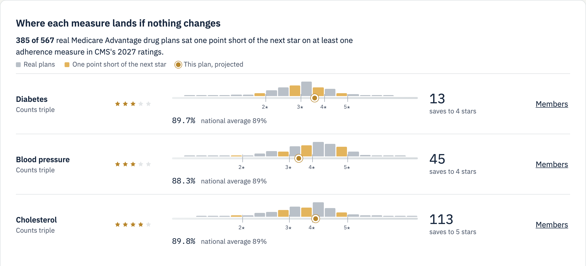

# Stars Desk

A Part D Stars pharmacist's desk. It answers one question for a Medicare Advantage clinical pharmacy team on October 1: which members move the plan's star ratings, and what should we do about each one?

The margin is thin. In CMS's 2027 ratings, 385 of 567 Medicare Advantage drug plans sat one point short of the next star on at least one adherence measure, and those three measures count triple ([CMS data tables](https://www.cms.gov/medicare/health-drug-plans/part-c-d-performance-data)).



The members and claims are a synthetic plan of 6,000 members. No real member or claim data is used. Measure rules, weights and cut points come from the CMS 2027 Star Ratings Technical Notes, and real plan scores from CMS's public 2027 data tables ([docs/SOURCES.md](docs/SOURCES.md)).


## What it does

- **Plan.** Projects where each Part D measure lands on December 31 from each member's own refill pattern, and how many members separate it from the next star, against the latest published cut points (2027 Star Ratings, standing in for the 2028 ratings that 2026 data feeds). Bars behind each measure show where every real Medicare Advantage drug plan scored in CMS's 2027 ratings, with the plans one point short of the next star in gold.
- **Call list.** For each member it shows days covered so far, how many more days they can miss and still reach 80%, the last day to refill, a likely barrier read from the claims and the fix to offer (a 90-day supply with auto-refill, one pharmacy with synced dates, a lower-cost option and an Extra Help check, or a clinical call about side effects). One call covers every adherence drug the member takes. It picks members a call can still help, then orders them by who has the least time to spare.
- **Judgment lanes.** Members who cannot reach 80% this year, new starts with one fill (a second fill adds them to the measure, so clinical need decides), and members whose claims show a therapy change (ask the prescriber, do not push a refill).
- **Safety faxes.** Statin use in diabetes, opioids with benzodiazepines and two anticholinergics, grouped into one fax per prescriber with a specific ask and references.
- **January changes.** Members hit by the plan's 2027 formulary changes, who has no room for a gap, a pharmacist switch note for the prescriber and a member letter held to a sixth grade reading level.


## What's checked

- **PDC math.** Same-ingredient overlapping fills shift forward, different ingredients do not, and inpatient and SNF stay days leave both sides. The engine matches the worked examples in CMS's Attachment L (`tests/pdc.test.js`).
- **Measure rules.** Denominators, exclusions, cut points, rounding and weights follow the CMS 2027 Technical Notes. Every rule is cited in [docs/SOURCES.md](docs/SOURCES.md).
- **Against real plans.** The desk's cut points match CMS's 2027 cut point file on all six measures. Its star logic gives the star CMS published on 3,320 of 3,336 real plan scores. The other 16 are plans CMS kept at their higher 2026 star because at least a quarter of their members lived in 2025 disaster areas (`tests/market.test.js`).
- **No peeking.** The desk reads only claims a plan would have on October 1. A test reruns every member of a test plan with later claims removed and gets identical output.
- **Member letters** stay at or below a sixth grade reading level, and a transition fill is promised only where the federal rule requires one.
- **Public text** carries no local paths (a guard test, shown failing on a planted path before it passed).

## How a pilot would prove it

The desk makes no outcome claim yet. This is the test that would earn one.

1. **October 1.** Take members who can still reach 80% on at least one adherence measure.
2. **Randomize** them into two arms with the same number of calls. Arm A gets the team's current list and script. Arm B gets the desk's list and matched fix.
3. **Log every call:** reached or not, the barrier the pharmacist found, the fix offered and accepted, and the follow-up date. The app's Log call outcome button captures these.
4. **December 31.** Compare the share of each arm at 80% PDC, using the CMS rules on the plan's own claims.

The pilot also measures saves per 100 calls, how often the desk's barrier guess matched what the pharmacist found, and how close the year-end projection came. Size it before the first call from the plan's own prior-year rate for members like these, and set the margin that would justify adopting the desk in advance. Both arms keep the plan's standard reminders, pharmacists can override the list, and no member is denied a clinical call.

## About the simulator

`eval/` holds a simulator used during development to check the code's logic: that the desk never reads hidden data, that lanes and rankings behave as designed, and that nothing breaks on harder synthetic plans. Its effect sizes depend on call success rates that were assumed, not measured, and the barriers it hides are the same types the rulebook reads. So its outputs are logic checks, not results, and this README quotes none of them. Details are in [docs/METHOD.md](docs/METHOD.md).

## What it can't do

- **It has no outcome evidence yet.** The pilot above is how to get it.
- **Its barrier rules are unchecked against real calls.** It names one barrier per drug from claims alone. The pilot's barrier-found field is the first real test of how often it's right.
- **Its ranking and projection use planning guesses.** How much a call can change each barrier, and how late a member tends to refill, are rules of thumb until a pilot measures them.
- **It reads claims only.** No lab values, no diagnoses beyond the measure exclusions, no notes from earlier calls. A pharmacist on the phone still has to confirm the barrier.
- **It doesn't know the 2028 cut points.** It uses the 2027 Star Ratings cut points, the latest published. The 2028 adherence measures may also add risk adjustment the desk doesn't model.
- **It doesn't optimize for the plan's overall star rating.** It does not model the summary rating, the reward factor or the improvement measures.
- **Its suggestions are prompts, not orders.** Lower-cost options, switch notes and fax asks are for the prescriber's judgment, and switches depend on the indication, which claims don't show.
- **Safety measures are part-year.** Opioid with benzodiazepine and anticholinergic overlap already past 30 days counts for this year no matter what the fax does.

## Run it

```bash
npm install
npm run build   # builds the synthetic plan's data, then the app
npm run dev     # prints a local address, open it
npm test        # PDC against the CMS worked examples, the rulebook, real plans, safety measures, the guards
npm run cms     # refreshes data/cms from cms.gov and checks each zip's SHA-256
```

`data/cms` holds a trimmed copy of CMS's public 2027 Star Ratings data tables: each contract's ID, its six Part D measure scores and stars, its 2025 disaster share and its 2026 stars. No plan names.

## Stack

React and Vite, plain JavaScript, Vitest. The engine in `src/engine` has no dependencies and is shared by the app, the data build and the simulator.

## License

MIT
