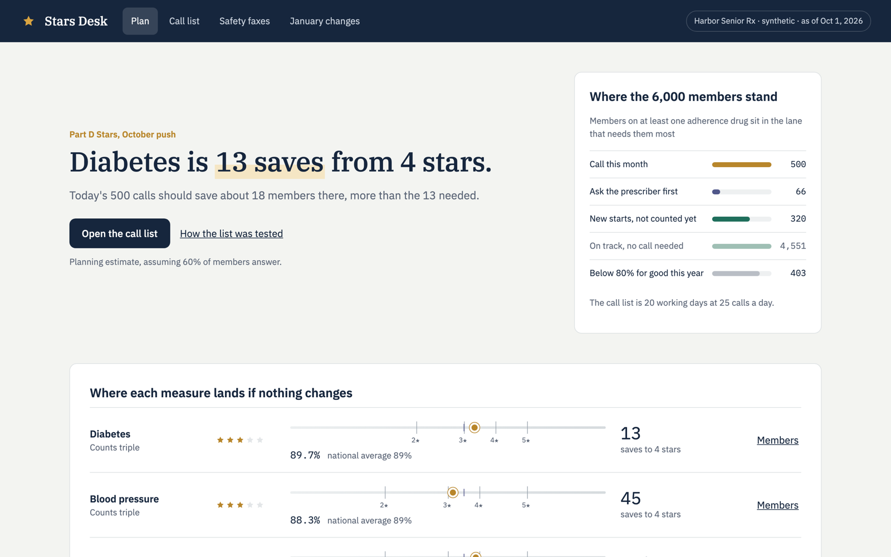
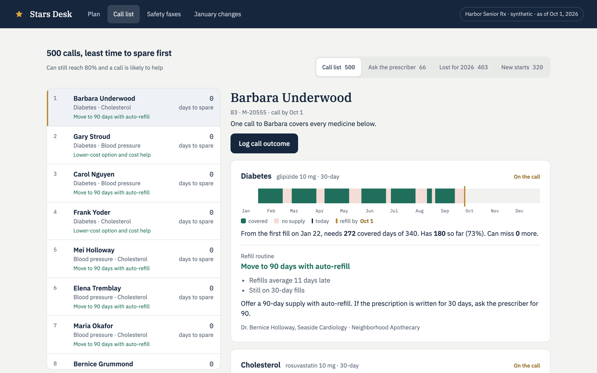

# Stars Desk

A Part D Stars pharmacist's desk. It answers one question for a Medicare Advantage clinical pharmacy team on October 1: which members move the plan's star ratings, and what should we do about each one?

Everything runs on a synthetic plan of 6,000 members. No real member, claim or plan data is used. Measure rules, weights and cut points come from the CMS 2027 Star Ratings Technical Notes ([docs/SOURCES.md](docs/SOURCES.md)).



## What it does

- **Plan.** Forecasts where each Part D measure lands on December 31 and how many saves separate it from the next star, against the latest published cut points (2027 Star Ratings, standing in for the 2028 ratings that 2026 data feeds).
- **Call list.** Ranks members by expected saves. For each member it shows days covered so far, the gap budget left, the last day to refill, a likely barrier read from the claims and the fix to offer (a 90-day supply with auto-refill, one pharmacy with synced dates, a lower-cost option with Extra Help and the Medicare Prescription Payment Plan, or a clinical call about side effects). One call covers every adherence drug the member takes.
- **Judgment lanes.** Members who cannot reach 80% this year, new starts with one fill (a second fill adds them to the measure, so clinical need decides), and members whose claims show a therapy change (ask the prescriber, do not push a refill).
- **Safety faxes.** Statin use in diabetes, opioids with benzodiazepines and two anticholinergics, grouped into one fax per prescriber with a specific ask and references.
- **January changes.** Members hit by the plan's 2027 formulary changes, who has no room for a gap, a pharmacist switch note for the prescriber and a member letter held to a sixth grade reading level.

## How well it works



Scored by playing October 1 to December 31 forward on each plan, with and without 500 member calls, and counting members who finished at or above 80% because of a call. Per 100 calls:

| Call list | Development (5 plans) | Held-out (3 plans, scored once) |
| --- | --- | --- |
| Under 80%, lowest first | 2.4 | 1.5 |
| Most overdue first | 3.2 | 3.1 |
| Under 80%, closest to 80 first | 11.2 | 11.8 |
| Fewest missed days left first (strongest plain list) | 14.0 | 12.5 |
| Desk order, plain reminder call | 14.5 | 14.1 |
| **Desk order and matched fix** | **27.4** | **27.1** |

What carries the result is the fix, not the ordering. Against the list a capable adherence team already uses (skip members who cannot reach 80%, call those with the fewest missed days left first), the desk's ordering with a plain reminder adds a little. Reading the barrier from the claims and offering the matching fix roughly doubles the saves. Across 27 combinations of the call assumptions (reach, fix rate and how often a pharmacist finds the barrier on the phone), the full desk beat the strongest plain list in all 27 on both sets.

These are version 2 plans. They include add-on ezetimibe and amlodipine that can look like a switch, members with two barriers at once, and members no fix reaches. Their held-out settings were written by a separate agent that never saw the desk's rules and were hashed before the one run. The barrier guess matched the simulator's hidden barrier for 1,056 of 1,921 called member-drugs on held-out (55%). The rulebook has no label for two barriers at once, so that share is lower than on version 1. Version 1 results stay in `eval/results` (held-out desk 24.6 against 10.2).

The plans and the call effects are simulated. That makes this a test of the ranking and the fixes given those mechanics, not a measured result on real members. A pilot with real outreach logs would measure reach and fix rates directly.

The method, the assumptions and what this does not show are in [docs/METHOD.md](docs/METHOD.md).

## Run it

```bash
npm install
npm run build   # builds the synthetic plan's data, then the app
npm run dev     # prints a local address, open it
npm test        # PDC against the CMS worked examples, the rulebook, safety measures, the public text guard
```

`node eval/run-eval.mjs dev` reruns the development evaluation. The held-out evaluation has already run once and refuses to run again.

## Stack

React and Vite, plain JavaScript, Vitest. The engine in `src/engine` has no dependencies and is shared by the app, the data build and the evaluation.

## License

MIT
